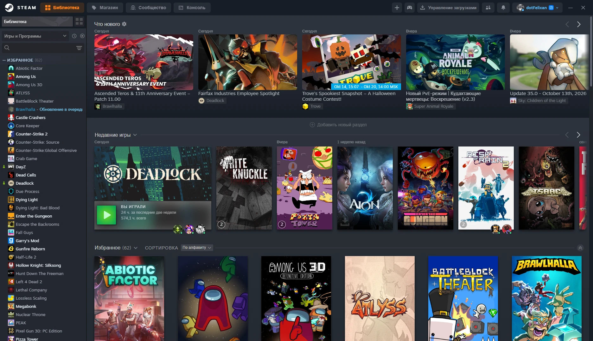
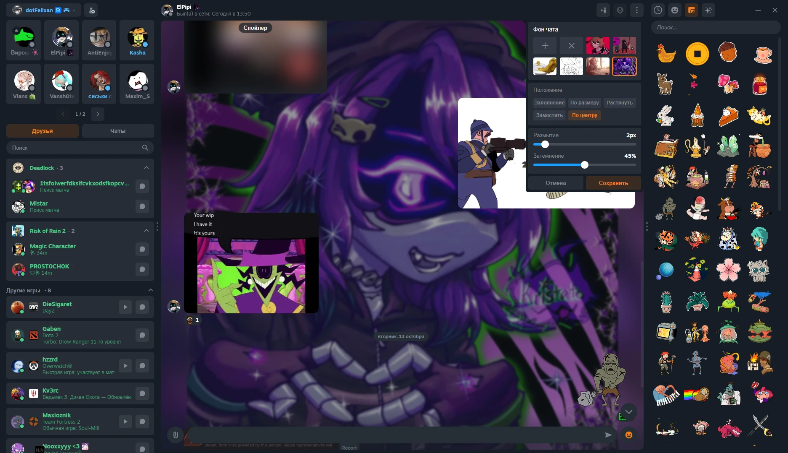

  

<h1 align="center">NEVKO-UI</h1>

  <b>Another design for Steam</b> - a theme for <a href="https://steambrew.app">Millennium</a>

  
  
  
  

  

  

> [!NOTE]
> The theme is being rewritten and is still a work in progress - things may change. It is **not abandoned**.

---

## Progress

| Area | Progress | |
| :-- | :-- | --: |
| **Header** | `▰▰▰▰▰▰▰▰▱▱` | ~80% |
| **Friends & Chats** | `▰▰▰▰▰▰▱▱▱▱` | ~60% |
| **Library** | `▰▱▰▱▰▱▰▱▰▱` | in progress |
| **Everything else** | `▱▱▱▱▱▱▱▱▱▱` | not started |

---

## Installation

1. Install [Millennium](https://steambrew.app).
2. Install **NEVKO-UI** from the Millennium theme library - or download this repository and put the folder into `Steam/millennium/themes`.
3. Pick the theme in Millennium and restart Steam.
4. *(Optional)* Install the **Recent Chats** plugin to get the *Chats* tab in the friends list.

---

## Features

<b>General</b>

- **Badges for Contributors** - special badges on the profiles of theme contributors
- **Rounding Avatars / Framed Avatars** - how round or sharp avatars look
- **Online Indicator** - modern dot-style badge or the legacy one
- **Avatar Decoration** - hide avatar frames
- **Hide Custom Username Icon**
- **Relative Last Seen** - exact time (*Last seen: Today at 14:00*) or the usual *3 hours ago*
- **Bypass Age Verification** - pass the age check on store pages automatically

<b>Friends & Chat</b>

- **Default Friends Tab** - open *Friends* or *Chats* on launch
- **Hide Friends Tabs** - hide the *Friends / Chats* tabs above the list
- **Group Chats Position** - group chats above or below recent chats
- **Hide Unread Count** and **Hide Unread Messages Group**
- **My Messages Side** - your messages on the right or on the left
- **Chat Avatars** - avatars beside messages in one-on-one chats
- **Rounding Messages** - how round message bubbles look
- **Message Field Buttons** - emoticon and attachment buttons outside or inside the field
- **Emoticon Side Panel** - dock the emoticon menu as a side panel
- **Emoticon Size**, **Sticker Size**, **Stickers in Menu** (animated on hover or always)
- **Emoji Style** - System, Apple, Google, Twitter or Facebook
- **Emoticons in Message Field** - Steam emoticons as pictures while typing
- **Chat Header Background** - the friend's mini profile background behind the chat header

<b>Header</b>

- **Main Buttons** - text, icons, or both
- **Reorder Main Buttons** - swap *Store* and *Library*
- **Hide Profile Button** - useful buttons move to the account menu
- **Account Button** - default, minimal, hide balance and/or nickname
- **Compact Manage Downloads Button** - an icon with a progress bar
- **Steam Modes Button** - launch Big Picture or SteamVR
- **Window Buttons** - hide specific window control buttons

<b>Library</b>

- **Library Items** - hide *What's New* and *Add Shelf*
- **Achievements Tab** - hide *Recent* and *Unreached Achievements*
- **Remove Shiny Effect** - no shine on game cards

<b>Privacy</b>

- **Blur Account Name**
- **Blur Balance**

<b>Main & Experimental</b>

- **Context Menu** - Refresh (redesigned) or Legacy
- **Rounding Buttons** and **Button Press Animation**
- **Device Shown to Friends** *(experimental)* - show the Big Picture or Mobile mark next to your status

---

## Bug reports

I check everything before each update, but bugs may still be there. You can report any bug on the [Discord server](https://discord.gg/UuAQWZ9HxE) or in [GitHub Issues](https://github.com/dotFelixan/NEVKO-UI/issues).

---

## Credits

**Code borrowed from**

- [ShadowMonster99](https://github.com/shdwmtr) - JS & CSS from CompactHeader
- [kuska1](https://github.com/kuska1) - some CSS from Material Design
- [SpaceTheme](https://github.com/SpaceTheme) - CSS for the right-side game page

**Helped with the code**

- [motionarium](https://github.com/motionarium) - extra buttons and Driver (JS)
- [Claude](https://claude.ai) - scripts and CSS fixes

**Inspiration**

- [Juxtopposed](https://youtu.be/cDY2p1CTkPo) - future store ideas
- [УЧ Дизайн](https://youtu.be/k0YCMI2ntjE) - most of the design

Made by <a href="https://github.com/dotFelixan">dotFelixan</a>

