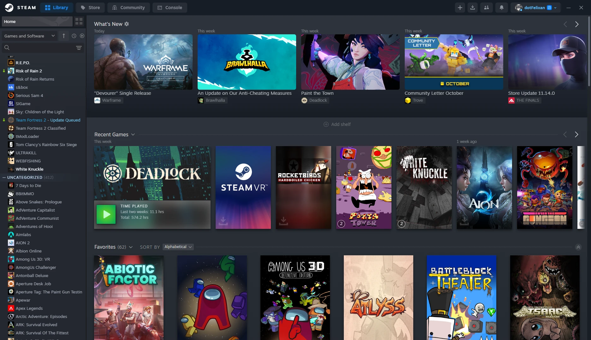
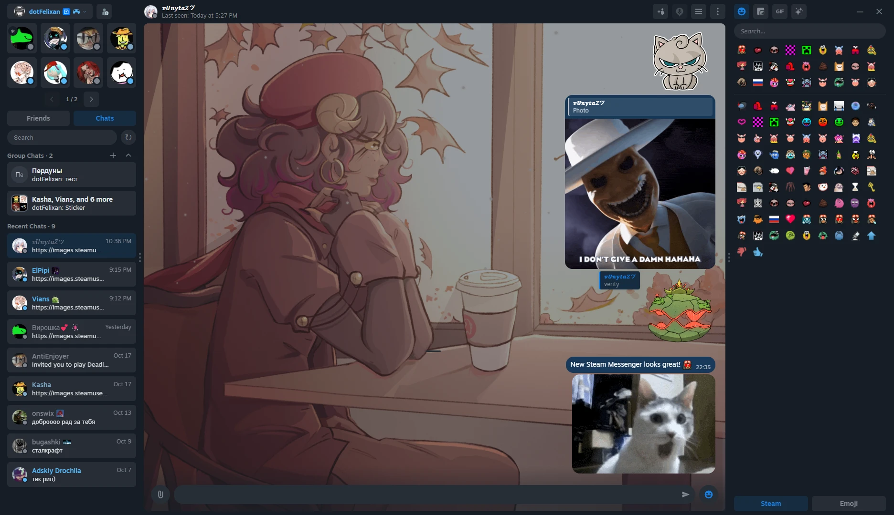
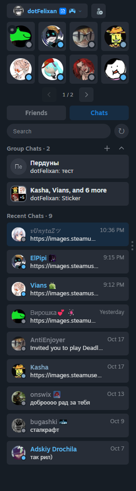
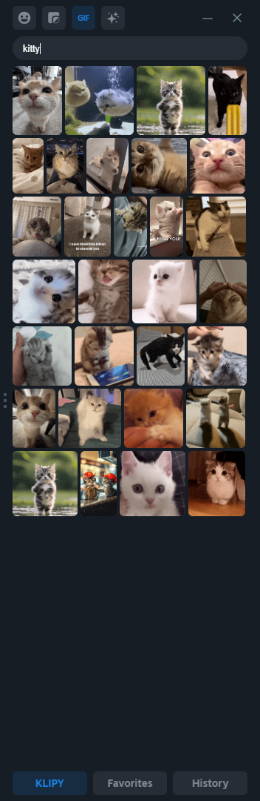

  

<h1 align="center">NEVKO-UI</h1>

Another design for Steam, made for <a href="https://steambrew.app">Millennium</a>

  <a href="https://discord.gg/UuAQWZ9HxE">Discord</a> ·
  <a href="https://t.me/dotSProjects">Telegram</a> ·
  <a href="https://boosty.to/dotfelixan">Support the project</a>

  

  

  
  &nbsp;
  

> [!NOTE]
> The theme is being rewritten, so some parts of Steam still look stock and things can change between updates. It's not abandoned.

## Installation

1. Install [Millennium](https://steambrew.app)
2. Find **NEVKO-UI** in the Millennium theme library, or download this repo and put the folder into `Steam/millennium/themes`
3. Pick the theme in Millennium settings and restart Steam

That's it, enjoy!

> [!TIP]
> Install [Recent Chats](https://github.com/Alex979/Steam-Recent-Chats-plugin) by Alex979 too. The Chats tab in the friends list needs it.

## Progress

| | |
| :-- | --: |
| Header | ~80% |
| Friends & Chats | ~80% |
| Library | in progress |
| Everything else | not started |

## Features

Everything below can be turned on and off in the theme settings.

**Friends & Chats**
- Chat docked to the friends list or in its own window, with a header or tabs
- Replies that remember the exact message, jump to it on click, work in group chats and on stickers and GIFs
- Deleted and expired messages stay in the chat, with a list of them in the chat menu.
- GIF tab in the emoticon menu (Giphy or Klipy), with favorites and history
- Emoticon menu as a side panel
- Custom background for every chat
- Names inside the bubble in group chats
- Your messages on the right or on the left
- Emoji style: System, Apple, Google, Twitter or Facebook
- Emoticon and sticker size, stickers and GIFs animated on hover
- Chat logs saved as txt files
- Group chats above or below recent chats

**Header**
- Text, icons or both on the main buttons
- Compact download button with a progress bar
- Account button styles
- Profile button moved into the account menu
- Big Picture and SteamVR button
- Hide window buttons

**Library**
- Hide What's New and Add Shelf
- Hide parts of the achievements tab
- No shine on game covers

**Appearance**
- Rounding for avatars, group avatars, framed avatars, buttons and messages
- Modern or legacy online indicator
- Hide avatar frames
- Redesigned context menus
- Button press animation

**Privacy**
- Blur account name
- Blur balance

**Other**
- Exact "Last seen" time
- Skip the age check on store pages
- Fake device status, so friends see you on Big Picture or on your phone
- Badges for [Boosty](https://boosty.to/dotfelixan) supporters and people who helped with the theme (bug reports, fixes, ideas). They show up next to names across the whole client, for everyone who uses NEVKO-UI

## Found a bug?

Tell me on [Discord](https://discord.gg/UuAQWZ9HxE) or open an [issue](https://github.com/dotFelixan/NEVKO-UI/issues). A screenshot or a short video helps a lot.

## Credits

**Borrowed code**
- [ShadowMonster99](https://github.com/shdwmtr), CompactHeader (JS and CSS)
- [kuska1](https://github.com/kuska1), some CSS from Material

**Helped with the code**
- [motionarium](https://github.com/motionarium), extra buttons and Driver
- [Claude](https://claude.ai), scripts and CSS fixes

**Plugin**
- [Alex979](https://github.com/Alex979), Recent Chats

**Inspiration**
- [Juxtopposed](https://youtu.be/cDY2p1CTkPo), store ideas
- [УЧ Дизайн](https://youtu.be/k0YCMI2ntjE), most of the design

Made by <a href="https://github.com/dotFelixan">dotFelixan</a>

